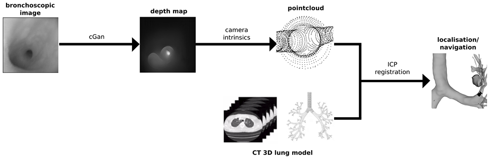

# Slicer-DepthMapTracking

A 3D Slicer module for vision-based bronchoscope tracking, developed for
[Visually navigated bronchoscopy using three cycle-consistent generative adversarial network for depth estimation](https://doi.org/10.1016/j.media.2021.102164)
(Banach et al., 2021). It registers depth maps estimated from bronchoscopic
images to an airway model to track the bronchoscope. The depth maps are
generated by [Visually_Navigated_Bronchoscopy](https://github.com/SNRLab/Visually_Navigated_Bronchoscopy).

## Citation

A. Banach, F. King, F. Masaki, H. Tsukada, N. Hata. "Visually navigated
bronchoscopy using three cycle-consistent generative adversarial network for
depth estimation." *Medical Image Analysis* 73 (2021): 102164.
https://doi.org/10.1016/j.media.2021.102164

## License

Distributed under the 3D Slicer license, a BSD-style license. See
[License.txt](License.txt).
